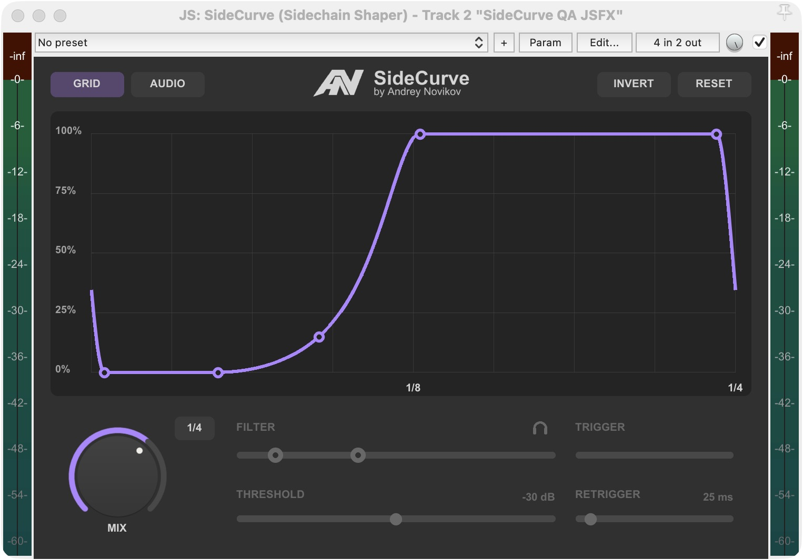

# SideCurve (Sidechain Shaper)

A standalone JSFX for REAPER with its own native resizable interface. No running
Lua frontend is needed. The approved AN maker mark accompanies SideCurve, with
a smaller regular-weight **by Andrey Novikov** signature beneath the product name.



## Install and update

Unzip the package, load **Install SideCurve.lua** through REAPER's Actions list,
and run it once. Add **SideCurve (Sidechain Shaper)** from the track FX browser.
The installer also enables RESET to read REAPER's saved user-default preset.
For a manual installation, copy `Effects/SideKick` into REAPER's resource folder.
Refresh the FX browser with F5 if REAPER still shows its previous cached name.

The internal path `Effects/SideKick/SideKick.jsfx` is intentionally retained so
projects saved with SideKick continue to find the same effect. It contains the
current SideCurve, not a second legacy version. Existing parameter slots are
unchanged. INVERT now reflects amplitude vertically instead of reversing time;
old projects with INVERT enabled therefore use the new requested behavior.

## Shape and timing

- **GRID** repeats the envelope in sync with the host timeline.
- **AUDIO** triggers one envelope pass from audio inputs **3/4**. A new attack
  can restart an unfinished pass from the actual current gain. After a pass the
  last anchor's gain is held until the next attack.
- The length button selects straight durations **2/1, 1/1, 1/2, 1/4, 1/8, 1/16,
  1/32, 1/64**. The graph labels half the duration at its center and the full
  duration at the right edge.
- **INVERT** reflects all levels vertically: `level -> 1 - level`. Point times
  and the shape's timing remain unchanged, including the boundary join.
- **MIX** blends dry and shaped audio. Drag vertically (Shift for finer control)
  or use the wheel. The arc follows the white dot. Percent is shown while the
  knob is pressed or dragged, and disappears on release. Double-clicking MIX
  restores 100 percent. Drag sensitivity is 12% slower than the previous preview.

Four anchors move in time and level. The middle handle changes the transition's
curvature vertically. Double-click a point to snap it to the nearest legal
**vertical musical grid line**, preserving its level. Double-clicking the middle
curvature handle snaps only points 2 and 4 to their nearest legal time-grid lines;
the middle handle remains between them. Levels and bend are preserved.
Ordinary dragging remains free, with no automatic snapping.

Hover directly over the region between points 2 and 4 to reveal its shading. Drag empty space in that region horizontally to move both anchors
together. Their spacing, levels and curvature remain unchanged; the region stops
at the outer anchors. Clicking a point takes priority over the region.
Drag the curve segment between points 1–2 or 4–5 vertically to raise or lower
that pair together. Relative levels and times are preserved, including at bounds.

The first and last anchors set the smooth transition across a GRID period's end
and beginning. Moving an outer anchor preserves the absolute inner-anchor times.
AUDIO replays the complete tail-plus-head join at each accepted attack, starting
from actual gain. It then holds the last anchor indefinitely, without looping.

## Detector and display

Send a trigger track's audio **1/2** to this track's inputs **3/4**. Opening the
JSFX window sets at least four track channels, preserving any higher count.

The detector filter covers **10 Hz–20 kHz**, with **48 dB/octave** Butterworth HP
and LP edges. Drag an edge or the selected band. Headphones audition the filtered
stereo sidechain and turn off when the window closes. THRESHOLD sets sensitivity;
RETRIGGER sets the minimum time between accepted attacks. Values show their units
at the right edge, for example **-30 dB** and **25 ms**. Detector controls are
inactive in GRID. The muted yellow TRIGGER bar shows gain reduction.

Gray peaks show processed main audio; purple peaks show filtered sidechain audio.
Square-root display scaling keeps quiet signals visible without changing audio.
All active purple controls use **#AF85FF**; gray overlays indicate disabled state.
The knob and brand block use cached supersampled native drawing for smooth
edges. PK and PLUGIN KING are vector outlines, independent of installed fonts.

**RESET** recalls the preset mapped by REAPER's **Save preset as default…**,
including one named **No preset**. Missing or malformed defaults use the factory
settings. New instances use the compact 698 x 478 initial size hint; REAPER
remembers resizing per existing JSFX instance.

## Checks

Tests execute the real JSFX through Cockos WDL EEL2:

```sh
python3 tests/test_engine.py /path/to/WDL/WDL/eel2/loose_eel
python3 tests/test_ui.py /path/to/WDL/WDL/eel2/loose_eel
```

See [validation](docs/VALIDATION.md) and [changelog](CHANGELOG.md). Source is MIT
licensed. The VST3 version is a separate native format, not a dependency.
