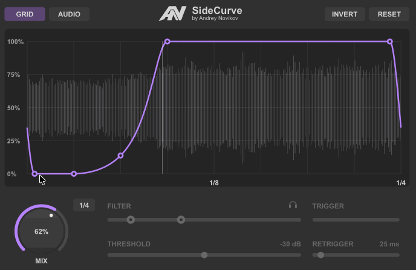
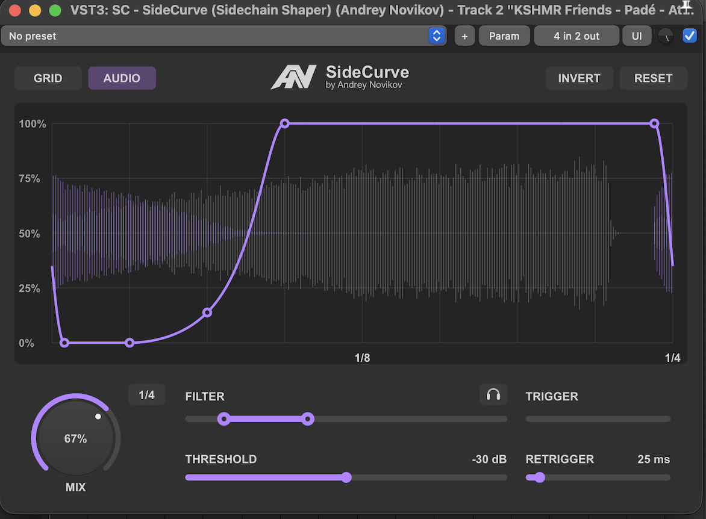
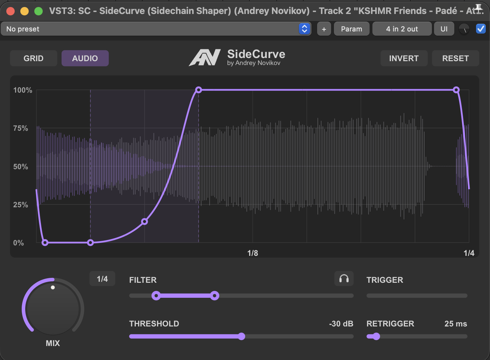

# SideCurve

**Sidechain Shaper · by Andrey Novikov**

**English** · [Русский](README.ru.md)

Shape your volume curve. Sync it to the beat or trigger it from audio.

[**Download**](https://github.com/andreynovikov86-cmd/SideCurve/releases/tag/v0.5.5) · [Installation](docs/INSTALL.md) · [Manual](docs/MANUAL.md)

*Recorded in REAPER. The GIF shows the actual plugin.*

## Shape the groove

| GRID | AUDIO | MIX |
| --- | --- | --- |
| Repeat your curve in sync with the project tempo. | Start the curve from a kick, snare or another sidechain signal. | Blend the effect with the original signal; see the percentage while adjusting. |

- **Edit the curve directly.** Move points, slide the central transition, or raise/lower the beginning and end as pairs.
- **Find the right trigger.** A 10 Hz–20 kHz detector filter, threshold, retrigger timing and headphone audition help isolate the sound you need.
- **See both signals.** Main and sidechain waveforms stay visible even at quiet levels.
- **Keep your setup.** Resizable interface, remembered window size, vertical INVERT and RESET to your saved default.

## Download

**Free and open source · MIT license**

| Platform | Format | Download |
| --- | --- | --- |
| macOS 11+ · Apple Silicon + Intel | Universal VST3 · 0.5.5 preview | [macOS ZIP](https://github.com/andreynovikov86-cmd/SideCurve/releases/download/v0.5.5/SideCurve-0.5.5-macOS-universal.zip) |
| Windows · x64 | VST3 · 0.5.5 preview | [Windows ZIP](https://github.com/andreynovikov86-cmd/SideCurve/releases/download/v0.5.5/SideCurve-0.5.5-Windows-x64.zip) |
| REAPER · macOS / Windows | JSFX · 0.4.5 | [JSFX ZIP](https://github.com/andreynovikov86-cmd/SideCurve/releases/download/v0.5.5/SideCurve-JSFX-0.4.5.zip) |

Unzip the VST3 package and copy the **entire SideCurve.vst3 bundle** into your VST3 folder, then rescan in your DAW. For JSFX, unzip its package and run the included **Install SideCurve.lua** once from REAPER's Actions list. [Full installation instructions →](docs/INSTALL.md)

The macOS preview is ad hoc signed and is not Apple notarized. Both VST3 builds passed the official Steinberg validator: **47 checks passed, 0 failed**. [Validation details](docs/VALIDATION.md)

## A closer look

### AUDIO mode and MIX

The percentage appears while you press or adjust MIX.

### Move the transition

Hover over the central region to reveal it, then drag horizontally to move the transition. Points remain individually editable.

## Get started in REAPER

1. Insert SideCurve on the track you want to shape.
2. Choose **GRID** for a tempo-synced repeating curve.
3. For **AUDIO**, send the trigger track's channels **1/2 → 3/4** on the SideCurve track, then adjust FILTER and THRESHOLD.
4. Shape the curve and set MIX by ear.

In AUDIO mode, each accepted trigger starts one pass. After it finishes, the last point's level is held until the next trigger.

[Detailed controls and building from source](docs/MANUAL.md) · [JSFX documentation](JSFX/README.md) · [Changelog](CHANGELOG.md) · [MIT license](LICENSE)

VST is a trademark of Steinberg Media Technologies GmbH. Third-party notices are included in [THIRD_PARTY_NOTICES.md](THIRD_PARTY_NOTICES.md).
