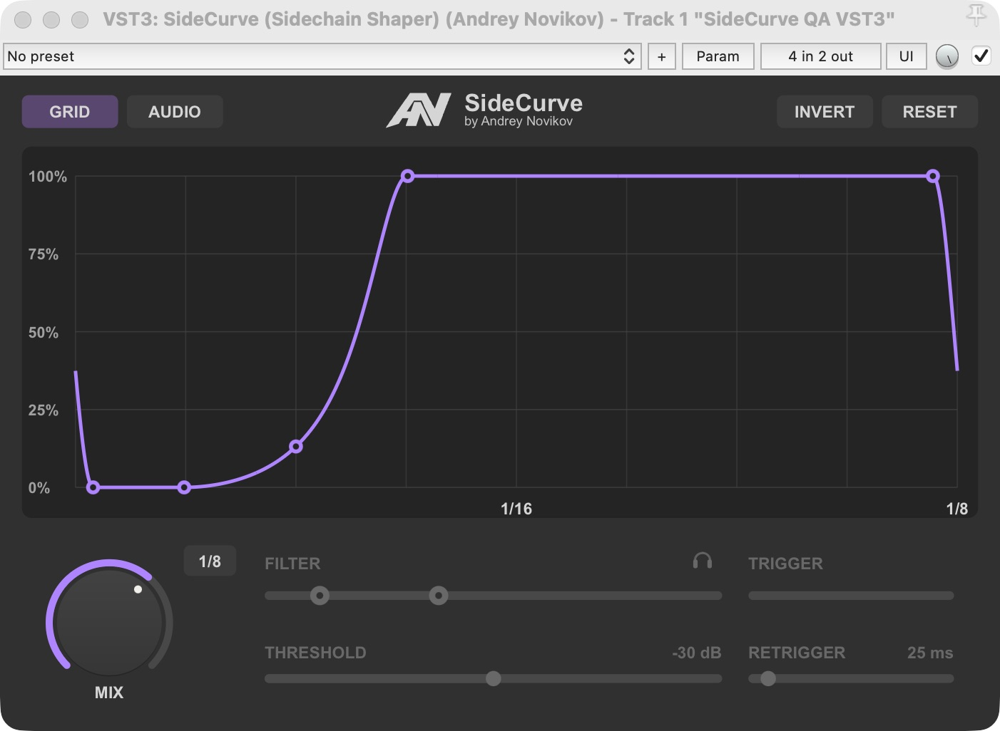

# SideCurve (Sidechain Shaper)

A native VST3 volume shaper for macOS and Windows, with the approved AN maker
mark and a custom resizable interface directly in the DAW. No Lua or JSFX dependency.
The title combines AN, SideCurve and a smaller regular-weight **by Andrey Novikov**
signature. The maker mark is vector artwork; no external font file is bundled.
The VST3 manufacturer is **Andrey Novikov**. Rescan changed plugins if an older
cached build still appears under Plugin King.



[Download releases](https://github.com/andreynovikov86-cmd/SideCurve/releases) · [JSFX for REAPER](JSFX/README.md)

The macOS universal VST3 and standalone JSFX have been packaged locally.
Public release upload is pending. Windows x64 build and validation are prepared
in GitHub Actions; no Windows binary has been verified in this workspace.


## Controls

- **GRID** repeats the envelope in sync with the project tempo.
- **AUDIO** starts a single pass on each detected sidechain attack. In REAPER,
  send source audio 1/2 to the effect track's channels 3/4.
- **INVERT** reflects levels vertically (`y -> 1 - y`), preserving point times.
- **RESET** recalls REAPER's saved user default from a focused track FX window;
  otherwise it restores factory settings.
- **MIX** blends dry and shaped audio. The purple arc follows its near-rim white
  dot; percent is visible only while pressed/dragged. Drag vertically, Shift for
  fine adjustment, wheel for increments, double-click MIX for 100 percent.
  Drag sensitivity is 12% slower than the previous preview.
- Select straight durations **2/1 to 1/64**. The graph shows half the duration
  at its center and the full length at its right edge.

Four anchors move freely in time and level. A middle handle controls curvature.
Double-click an anchor to snap to the nearest legal **vertical musical grid line**
without resetting its level. The middle handle's double-click snaps only points 2 and 4 to their nearest
legal time-grid lines. The middle handle remains between them, and levels and
bend are preserved.

Hover directly over the region between points 2 and 4 to reveal its shading.
Drag empty space there horizontally to move both anchors, preserving width, levels
and bend. Point dragging takes precedence and outer anchors bound the movement.
Drag the curve segment between points 1–2 or 4–5 vertically to raise or lower
that pair together. Relative levels and times are preserved, including at bounds.

The curve is smooth at anchors and across GRID period boundaries. Outer anchors
set the end-to-start transition. In AUDIO every accepted attack starts from actual
gain, replays the whole tail-plus-head join, and holds the final point's level
after completion until the next attack. Early attacks can restart an active pass.

The HP/LP detector filter covers **10 Hz–20 kHz** with **48 dB/octave** Butterworth
edges. Drag either edge or the whole selected band. Headphones audition the
filtered sidechain and turn off on editor close. THRESHOLD and RETRIGGER control
sensitivity and minimum attack spacing; their values show dB/ms on the right.
Detector controls are disabled in GRID. All control rails have equal thickness.

Gray peaks show processed main audio; purple peaks show the filtered sidechain.
Square-root display scaling reveals quiet signals without changing audio. Yellow
TRIGGER indicates gain reduction. Active purple controls share **#AF85FF**.
Window resizing persists for later instances on the same computer.

## Compatibility and status

The bundle is now **SideCurve.vst3**. Stable processor/controller class IDs and
parameter IDs are retained from SideKick. Saved-state loading after renaming was
checked in an isolated REAPER project. INVERT intentionally has new vertical
semantics, including when it was enabled in an older saved project.

The macOS universal build and editor were checked locally. Windows x64 build and
validation are prepared in GitHub Actions but have not been run in this workspace.
See [validation](docs/VALIDATION.md) and [installation](docs/INSTALL.md).

## Build

CMake 3.25+, C++17, official VST3 SDK revision
`3cdf9ca5d1f5b1b21e0a86832aa4abe55607bd96`, including base, cmake,
pluginterfaces, public.sdk and vstgui4 submodules:

```sh
cmake -S . -B build -DVST3_SDK_ROOT=/absolute/path/to/vst3sdk -DCMAKE_BUILD_TYPE=Release
cmake --build build --config Release --target SideKick sidekick_tests sidekick_trace validator
ctest --test-dir build -C Release --output-on-failure
python3 tools/validate.py build
```

SideKick remains the internal CMake target name; the produced bundle is SideCurve.
For universal macOS add `-DCMAKE_OSX_ARCHITECTURES="arm64;x86_64"` and
`-DCMAKE_OSX_DEPLOYMENT_TARGET=11.0`. On Windows use Visual Studio 2022+ x64.

`reference/SideCurve.jsfx` is the versioned 0.4.5 EEL2 audio reference; it is not
loaded by the VST3. Compare actual C++ and EEL2 output at 44.1/48/96 kHz with:

```sh
python3 tests/conformance.py build/sidekick_trace /path/to/WDL/WDL/eel2/loose_eel
```

MIT source license. VST3 SDK and VSTGUI notices are in licenses/. VST is a
trademark of Steinberg Media Technologies GmbH.
